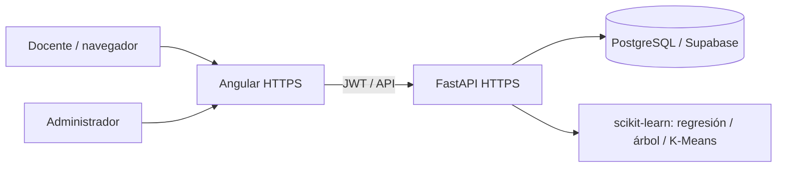

# Plataforma de Gestión Académica Docente — manual técnico y arquitectura

**Alcance:** demostración académica con datos sintéticos. No usar registros reales de menores ni credenciales institucionales.

## Arquitectura

## Componentes y derechos de acceso

| Componente | Función | Autorización |
|---|---|---|
| `auth/login`, `auth/register` | Inicio y alta con invitación | Registro con código de un uso |
| `course-sections`, `activities/grades` | Consultar cursos, guardar notas 0–20 | Docente asignado o admin |
| `weekly-schedule` | Leer clases semanales | Solo clases del docente o admin |
| `weekly-schedule` POST/PUT/DELETE | Planificar horario | Solo admin; rechaza choque de docente/aula |
| `course-sections/{id}/exam-schedules` | Consultar exámenes | Docente del curso |
| `activities/{id}/schedule` PUT/DELETE | Programación de evaluación | Docente del curso |
| `reports`, `reports/{id}/csv` | CSV e historial persistente | Reportes propios; admin puede descargar por ID |
| `ml/predict`, `ml/groups` | Predicciones y grupos | Docente del curso; datos sintéticos |

## Instalar localmente

1. Variables locales `.env`, consultar `.env.example`; nunca subir credenciales.
2. `docker compose up -d --build` desde la raíz (esperar a que `/api/v1/ready` responda).
3. `cd Frontend; npm ci; npm start` (Angular `http://localhost:4200`).
4. En otra terminal: `cd Backend; python -m pytest -q --disable-warnings`.
5. `cd Frontend; npx vitest run; npm run build`.

## Manual para docentes

1. Inicia sesión con una cuenta de demo autorizada; al cerrar sesión se elimina el token local.
2. En Cursos selecciona una sección y abre Registro de calificaciones.
3. Edita una nota entre 0 y 20 y sal del campo; espera confirmación y recarga para validar que PostgreSQL conserva el valor. Una nota vacía es distinta de 0.
4. Estadísticas muestran cálculos de notas sintéticas registradas, no decisiones académicas oficiales.
5. Exámenes: selecciona actividad, fecha, hora y aula; guarda y recarga. Se lee desde PostgreSQL.
6. Reportes: genera CSV; el archivo se guarda también en la BD para que puedas volver a descargarlo desde el historial.
7. Horario: consulta las clases asignadas al docente; cambian visualmente las semanas, pero las clases recurrentes se repiten. No hay excepciones de feriados.
8. Indicadores de riesgo: predicciones de demostración, **no diagnóstico estudiantil**.

## Manual del administrador

1. Entra con rol admin (no habilitar credenciales demo predecibles en un despliegue público).
2. Menú Administración: emite código de invitación, envíalo por un canal privado y no lo registres en capturas.
3. Tras el registro, asigna el curso al docente.
4. Programa clases semanales con día, hora y aula; el servidor rechaza conflictos.
5. Para un entorno de demo local vacío, opción **Cargar horario sintético** genera un horario de ejemplo. No modificar horarios reales con ella.

## Persistencia y migraciones

`0001` esquema académico; `0002` RLS; `0003` invitaciones, exámenes e historial; `0004` horario semanal y CSV de reportes. `app.prestart` aplica Alembic `head` al arrancar Docker. **Respaldar PostgreSQL antes de reiniciar con nuevas migraciones.** No utilizar `docker compose down -v`.

## Métricas: restricciones y honestidad

MAE, RMSE, accuracy y F1 se obtuvieron con datos sintéticos; no son evidencias de efectividad en alumnos reales. Las 90 peticiones locales anteriores fueron secuenciales, no un test concurrente de carga. Registrar cualquier resultado nuevo con fecha, entorno, método y muestra.

## Pendientes para despliegue académico por HTTPS

- `DATABASE_URL` privada de Supabase; SSL habilitado.
- `JWT_SECRET_KEY` aleatoria (>=32 caracteres), `SEED_DEMO_DATA=false` y `APP_ENV=production`.
- `CORS_ORIGINS` debe contener solamente la URL HTTPS del Angular público.
- Sitio estático: `ITD_API_URL=https://TU-API.onrender.com/api/v1`; no colocar contraseña ni token.
- La base pública debe tener **solo datos sintéticos** y cuentas de demo con contraseñas nuevas, nunca las publicadas en el repositorio.
- Verificar `/ready`, login, separación entre docentes, autoguardado, exámenes, reportes e inferencia en la URL publicada.
- Los scripts de prueba no sustituyen una auditoría de seguridad institucional ni la revisión de restauración de backups.

## Alcance conocido

Sin notificaciones por feriados, sin acceso institucional real, sin asistencia diaria registrada, sin conexión con SSO escolar. Formularios, perfiles, concurrencia y accesibilidad requieren pruebas end-to-end manuales.
